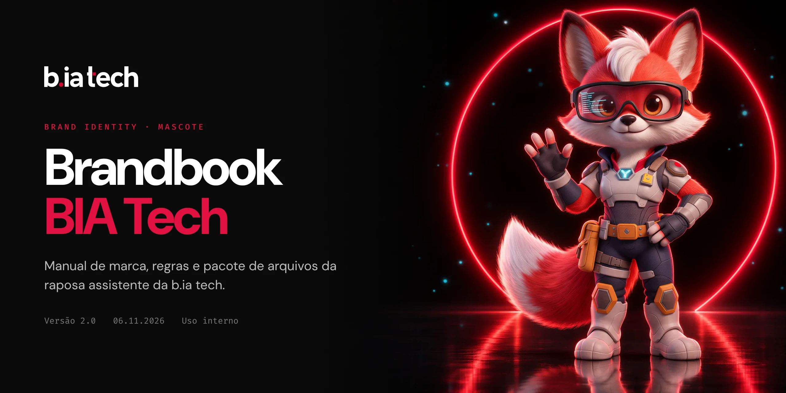

# Brandbook BIA Tech

Manual de marca e pacote de arquivos da **BIA Tech**, a mascote da **b.ia tech** (Bradesco Inteligência Artificial). Aqui está tudo o que o time precisa para usar a personagem do jeito certo: regras, lockups, avatares, fundos do Teams, papéis de parede, stickers, as artes-base para gerar peças novas e o modelo 3D da personagem.

`Versão 2.1` · `13/11/2026` · `Uso interno`

## Sumário

- [Começo rápido](#começo-rápido)
- [Como abrir o brandbook (HTML)](#como-abrir-o-brandbook-html)
- [O que tem em cada pasta](#o-que-tem-em-cada-pasta)
- [Qual arquivo usar em cada situação](#qual-arquivo-usar-em-cada-situação)
- [Regras essenciais](#regras-essenciais)
- [Como aplicar as peças mais pedidas](#como-aplicar-as-peças-mais-pedidas)
- [Criar artes novas da BIA](#criar-artes-novas-da-bia)
- [Modelo 3D](#modelo-3d)
- [Histórico de versões](#histórico-de-versões)

## Começo rápido

1. Na página do repositório, clique em **Code → Download ZIP** e descompacte em qualquer pasta.
2. Abra `brandbook-html/index.html` com dois cliques. Ele abre no navegador, sem instalar nada.
3. Use o botão de download de cada peça no próprio manual, ou pegue os arquivos direto nas pastas `01` a `10`.

> Prefere o terminal? `git clone https://github.com/johnlaff/brandbook-bia-tech.git` funciona igual. O repositório tem cerca de 370 MB, então o ZIP costuma ser mais rápido.

## Como abrir o brandbook (HTML)

O manual é uma página única em `brandbook-html/index.html`. Ele mostra cada regra com exemplo visual e permite:

- **Baixar cada peça** no arquivo final, em PNG ou JPG em resolução cheia. O botão aparece ao passar o mouse e fica sempre visível no celular.
- **Ampliar em tela cheia** com um clique na imagem, navegando pelas setas, pelo teclado (← →, Esc) ou deslizando o dedo.
- **Ver os stickers em chat claro ou escuro.**
- **Marcar a checklist de aprovação** de artes novas. O navegador lembra o que já foi conferido.
- **Copiar o código de uma cor** com um clique no chip da paleta.

| Onde | Como |
|---|---|
| No seu computador | Baixe o ZIP, descompacte e abra `brandbook-html/index.html`. Os botões de download só funcionam com as pastas `01` a `09` ao lado de `brandbook-html/`, como vêm no ZIP. |
| Online | Peça o link da versão publicada a quem mantém o brandbook. |

**Observações:**

- Abrir o `index.html` pelo site do GitHub mostra só o código, não a página. Baixe o arquivo antes.
- As fontes vêm do Google Fonts. Sem internet, a página continua funcionando, mas com a fonte padrão do sistema.

## O que tem em cada pasta

| Pasta | Conteúdo | Formatos |
|---|---|---|
| `brandbook-html/` | O manual completo e as imagens de prévia dele | HTML, WebP |
| `01-lockups/` | BIA + wordmark b.ia tech, horizontal e vertical, nas versões positivo, negativo e vermelho | PNG 1600 px (positivo com fundo transparente) |
| `02-icones-e-avatares/` | Ícone de app 1024 (quadrado e arredondado), foto de perfil, avatares circulares (vermelho, escuro, claro) e favicons de 16 a 512 px | PNG, ICO |
| `03-fundos-teams/` | 5 fundos de vídeo: vermelho, branco, claro mínimo, monumento e terminal | JPG 1920x1080 |
| `04-papeis-de-parede/` | Desktop e celular, nas versões terminal/escuro e vermelho | PNG 2560x1440 e 1179x2556 |
| `05-apresentacao/` | Capa de apresentação | PNG 1920x1080 |
| `06-redes-e-email/` | Banner do LinkedIn e assinatura de e-mail | PNG 1584x396 e 600x150 |
| `07-stickers/` | 10 stickers de chat com legenda: Bom dia, Valeu, Top, Bora, Deploy feito, Entendi, Hmm, Ops, Reunião, Até | PNG e WebP 512x512 (< 100 KB) |
| `08-personagem/` | Poses recortadas, fichas oficiais (turnaround, expressões, poses, detalhes, retrato), `bia-tech.json` e `prompt-mestre.txt` | PNG transparente, JSON, TXT |
| `09-marca/` | Wordmark b.ia tech | SVG (positivo, negativo, branco) |
| `10-modelo-3d/` | Modelo 3D da BIA (Prévia 5.5.4), com esqueleto, 8 animações e 11 expressões: arquivo do Blender com as texturas, GLB completo e GLB leve para web | BLEND, PNG, GLB |

## Qual arquivo usar em cada situação

| Preciso de... | Use |
|---|---|
| Logo em documento ou slide com fundo claro | `01-lockups/lockup-horizontal-positivo.png` |
| Logo sobre fundo escuro ou vermelho | `lockup-horizontal-negativo.png` ou `lockup-horizontal-vermelho.png` |
| Espaço mais alto do que largo (cartaz, story, totem) | `01-lockups/lockup-vertical-*.png` |
| Foto de perfil (Teams, Slack, bot) | `02-icones-e-avatares/avatar-circular-vermelho.png` |
| Ícone de app ou PWA | `icone-app-1024.png` (o sistema aplica a máscara) ou `icone-app-1024-arredondado.png` |
| Ícone de aba do navegador | `favicon.ico` + `favicon-*.png` |
| Fundo de chamada no Teams | `03-fundos-teams/` |
| Reagir no chat | `07-stickers/` (WebP no WhatsApp, PNG no Teams) |
| Ilustrar um slide com a BIA | `08-personagem/poses-recortadas/` |
| Só o nome da marca, sem a personagem | `09-marca/biatech-*.svg` |
| Animar a BIA ou fazer um render novo em 3D | `10-modelo-3d/bia-tech.blend` (Blender 5.3 ou mais novo) |
| A BIA em 3D num site, app ou motor de jogo | `10-modelo-3d/bia-tech-web.glb` (web) ou `10-modelo-3d/bia-tech.glb` |

## Regras essenciais

O detalhe completo está no manual. Estas são as que mais se perdem:

- **Grafia:** "BIA Tech" é a personagem; "b.ia tech" (minúsculas, com ponto) é a marca.
- **Hierarquia:** Bradesco > b.ia tech > BIA Tech. A BIA aparece sempre ao lado do wordmark b.ia tech, nunca no lugar dele. O endosso Bradesco fica fora da área de proteção e segue a própria área de 2X.
- **Área de proteção:** 1X ao redor do lockup, em que X é a altura do "b" do wordmark.
- **Tamanho mínimo:** lockup com 180 px, corpo inteiro com 96 px, avatar com 32 px. Abaixo disso, use o favicon do rosto.
- **Anatomia:** sempre 2 braços, 3 dedos + polegar e os dois olhos castanhos. O HUD ciano fica só sobre o olho direito dela.
- **Não faça:** espelhar, esticar, recolorir, inventar um logo "BIA Tech" ou tirar os óculos da BIA. Em incidentes, comunicados regulatórios e más notícias, use só o wordmark.

## Como aplicar as peças mais pedidas

<details>
<summary><b>Fundo do Teams</b></summary>

Em uma chamada, clique em **Mais (…) → Efeitos de vídeo → Mais efeitos de vídeo → Adicionar novo** e escolha um JPG de `03-fundos-teams/`. Os fundos são feitos para a sua imagem ficar no centro. O Teams espelha o seu vídeo só para você: os participantes veem o logo do jeito certo.
</details>

<details>
<summary><b>Stickers no WhatsApp e no Teams</b></summary>

- **WhatsApp:** os WebP de `07-stickers/` seguem o formato exigido (512x512, abaixo de 100 KB, margem de 16 px). Use um app criador de pacotes para importar.
- **Teams:** cole o PNG direto na conversa ou salve-o como figurinha personalizada.
</details>

<details>
<summary><b>Favicon em um site interno</b></summary>

Copie os arquivos de `02-icones-e-avatares/` para a raiz do site e coloque no `<head>`:

```html
<link rel="icon" href="/favicon.ico" sizes="any">
<link rel="icon" type="image/png" sizes="32x32" href="/favicon-32.png">
<link rel="apple-touch-icon" href="/favicon-180.png">
```
</details>

<details>
<summary><b>Assinatura de e-mail</b></summary>

No Outlook, vá em **Configurações → Contas → Assinaturas** e insira `06-redes-e-email/assinatura-email-600x150.png` como imagem, abaixo do seu nome e cargo.
</details>

## Criar artes novas da BIA

Toda arte nova parte das referências oficiais, para a personagem não sair do modelo:

1. Anexe ao gerador de imagens as fichas de `08-personagem/fichas/`, nesta ordem: retrato oficial, turnaround, poses e detalhes.
2. Cole o texto de `08-personagem/prompt-mestre.txt` e descreva só a cena nova.
3. Confira o resultado com zoom, usando a **checklist de aprovação** do manual. Se um item falhar, gere de novo: não retoque à mão.

`bia-tech.json` traz a ficha técnica da personagem (traços obrigatórios e paleta) em formato legível por máquina, para usar em ferramentas e automações.

## Modelo 3D

A pasta `10-modelo-3d/` traz o modelo 3D da BIA na **Prévia 5.5.4**: 295.400 triângulos, esqueleto de 101 ossos, 8 animações de corpo (Parada, Acenando, Explicando, Concordando, Comemorando, Dando de ombros, Andando e Correndo) e 11 expressões de rosto. A seção 16 do manual mostra as vistas, as animações e as regras de uso.

| Arquivo | Para que serve | Tamanho |
|---|---|---|
| `bia-tech.blend` + `textures/` | Arquivo de trabalho do Blender 5.3 ou mais novo, com luzes de estúdio e câmera. Para renders, poses novas e animações | 82 MB + 32 MB |
| `bia-tech.glb` | Modelo completo com esqueleto e animações, para outros programas 3D e motores de jogo | 24,7 MB |
| `bia-tech-web.glb` | Versão leve para sites e apps, com texturas em WebP | 12,6 MB |

- **Mantenha a pasta `textures/` ao lado do `bia-tech.blend`.** As texturas ficam fora do arquivo porque o GitHub não aceita arquivos acima de 100 MB. Se o Blender abrir o modelo cor-de-rosa, a pasta não está no lugar.
- É uma prévia, para testes e peças internas. Peças externas continuam saindo das artes das pastas `01` a `08` até a versão final do modelo.
- As regras da personagem valem em 3D: não espelhar, não recolorir, não mudar as proporções e não tirar os óculos, a mecha, o emblema ou o crachá.

Mais detalhes em [`10-modelo-3d/LEIAME.md`](10-modelo-3d/LEIAME.md).

## Histórico de versões

| Versão | Data | O que mudou |
|---|---|---|
| 2.1 | 13/11/2026 | Modelo 3D da BIA na pasta `10-modelo-3d/` e seção 16 no manual (entrou na Prévia 5.5.3 e passou no mesmo dia para a 5.5.4, com pelo na base da cauda); anatomia corrigida para 3 dedos + polegar, como nas fichas oficiais |
| 2.0 | 06/11/2026 | Arte dedicada para cada uso (lockups, fundos do Teams integrados à cena, stickers de chat), lockup vertical com a BIA debruçada, ícone de rosto para tamanhos pequenos, motion e interatividade no manual |
| 1.0 | 06/11/2026 | Primeira versão do manual e do pacote |

---

Material de uso interno. Bradesco e b.ia tech são marcas do Banco Bradesco S.A. Dúvidas sobre uso da marca: fale com o time responsável pela b.ia tech antes de publicar.
